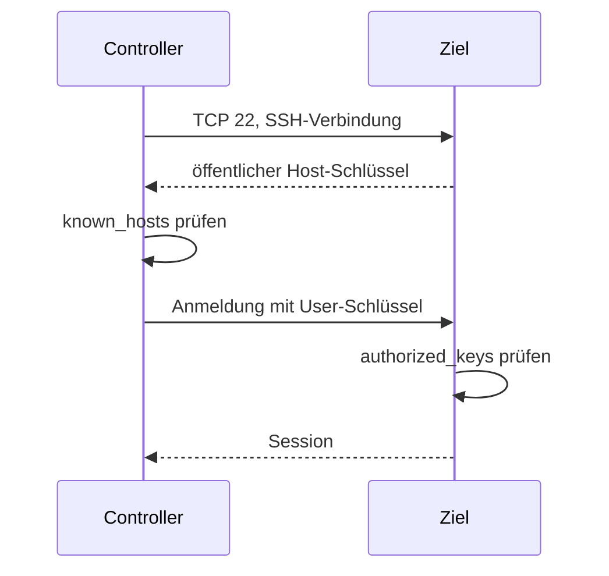

# 1 Grundlagen: SSH und YAML

> **💡** Ansible arbeitet über SSH und beschreibt den Sollzustand in YAML. Diese Seite fasst zusammen, was wir für die ersten Beispiele brauchen.

## SSH

### Warum SSH für Ansible?

Ansible ist agentless (ohne Agenten): Auf dem Ziel muss kein Ansible-Dienst laufen. Der Controller (Steuerrechner) verbindet sich per SSH, kopiert ein kleines Python-Modul, führt es aus und entfernt es wieder. Auf dem Ziel werden daher nur ein SSH-Server und Python 3 benötigt.

### Die vier Dateien

| Datei | Wo | Zweck | Rechte |
|---|---|---|---|
| `/etc/ssh/ssh_host_ed25519_key` | Ziel | Privater Host-Schlüssel: beweist die Identität des Servers | `600`, `root:root` |
| `~/.ssh/known_hosts` | Controller | Merkt sich den öffentlichen Host-Schlüssel des Ziels | `600` |
| `~/.ssh/id_ed25519` und `~/.ssh/id_ed25519.pub` | Controller | Persönliches Schlüsselpaar: privat bleibt lokal, öffentlich geht auf das Ziel | `600` / `644` |
| `~/.ssh/authorized_keys` | Ziel, im Home des Ziel-Users | Erlaubt die öffentlichen Schlüssel, die sich anmelden dürfen | `600`, Ordner `700` |

> **⚠️** Host-Schlüssel und User-Schlüssel sind verschieden: Der Host-Schlüssel identifiziert den Server, der User-Schlüssel identifiziert den Client.

### Ablauf



Beim ersten Verbindungsaufbau ist der Host-Schlüssel unbekannt. Der Fingerprint wird einmal bestätigt und in `known_hosts` gespeichert. Ändert sich der Host-Schlüssel später, warnt SSH.

### Befehle

```sh
ssh-keygen -t ed25519 -C "schueler@laptop"
ssh-copy-id -i ~/.ssh/id_ed25519.pub schueler@192.168.56.10
ssh schueler@192.168.56.10
```

`ssh-keygen` erzeugt das Schlüsselpaar. `ssh-copy-id` hängt den öffentlichen Schlüssel an `authorized_keys` auf dem Ziel. `ssh` testet die Anmeldung.

### Rechte

```sh
chmod 700 ~/.ssh
chmod 600 ~/.ssh/authorized_keys
chmod 600 ~/.ssh/id_ed25519
chmod 644 ~/.ssh/id_ed25519.pub
```

SSH lehnt Schlüssel ab, wenn die Rechte zu offen sind. Auf dem Ziel müssen `~/.ssh` und `authorized_keys` dem Ziel-User gehören.

### Übung

1. Auf dem Controller: `ssh-keygen -t ed25519 -C "schueler@laptop"`.
2. Auf dem Ziel: `sudo apt install openssh-server` und `sudo systemctl enable --now ssh`.
3. Auf dem Controller: `ssh-copy-id -i ~/.ssh/id_ed25519.pub schueler@192.168.56.10`.
4. Anmelden: `ssh schueler@192.168.56.10`. Den Host-Fingerprint beim ersten Mal bestätigen.
5. Prüfen: `ls -l ~/.ssh` auf beiden Seiten.
6. Optional: `ssh-keygen -R 192.168.56.10` entfernt den Host-Eintrag; beim nächsten Login wird der Fingerprint erneut bestätigt.

> **💡** Wir testen den Key-Login in einer zweiten SSH-Sitzung, bevor wir die Passwort-Anmeldung abschalten.

### Typische Fehler

| Fehler | Ursache | Prüfen |
|---|---|---|
| `Permission denied (publickey)` | Schlüssel fehlt in `authorized_keys`, falscher User oder falsche Rechte | `ssh -v`, `ls -l ~/.ssh` |
| `Connection refused` | SSH-Dienst läuft nicht | `systemctl status ssh` |
| Host-Key-Warnung | Ziel neu installiert oder Host-Schlüssel geändert | Fingerprint vergleichen, dann `ssh-keygen -R host` |
| Passwort wird verlangt | Public-Key-Authentifizierung greift nicht | `authorized_keys`, Rechte, `sshd -T` |

### Sicherheit

> **🔐** Private Schlüssel verlassen nie das Gerät. Wir setzen eine Passphrase, nutzen einen Schlüssel pro Gerät und schalten die Passwort-Anmeldung erst ab, wenn der Key-Login sicher funktioniert. Nach Änderungen an `sshd_config`: `sudo sshd -t` und dann `sudo systemctl reload ssh`.

### SSH in Ansible

```ini
[web]
ansible1 ansible_host=192.168.56.10 ansible_user=schueler
```

Ansible nutzt diese Inventory-Variablen für die Verbindung. Der private Schlüssel liegt standardmäßig in `~/.ssh/id_ed25519`; mit `ansible_ssh_private_key_file` lässt sich ein anderer Pfad setzen.

## YAML

> **💡** Zwei Einstiege:
> * [YAML – Wikipedia](https://de.wikipedia.org/wiki/YAML)
> * [Learn YAML in Y Minutes](https://learnxinyminutes.com/docs/yaml/)

YAML ist ein Datenformat, keine Programmiersprache. Es beschreibt verschachtelte Werte, Listen und Mappings (Zuordnungen); Ansible-Playbooks (Ablaufbeschreibungen) sind YAML-Dateien.

### Die wichtigsten Regeln

* Einrückung mit Leerzeichen, nie mit Tabs.
* Zwei Leerzeichen pro Ebene sind eine gute Konvention.
* `key: value` — nach dem Doppelpunkt folgt ein Leerzeichen.
* Listen beginnen mit `- `.
* Kommentare beginnen mit `#`.
* Strings mit Sonderzeichen werden in Anführungszeichen gesetzt, zum Beispiel `"0644"` oder `"yes"`.
* Booleans (Wahrheitswerte) sind `true` und `false`; leer ist `null`.
* `---` trennt Dokumente und ist in Playbooks optional.

> **⚠️** `yes` und `no` können als Boolean gelesen werden. Für Klarheit schreiben wir `true` und `false`.

### So sieht ein Playbook aus

```yaml
- name: Webserver einrichten
  hosts: web
  become: true
  tasks:
    - name: nginx installieren
      ansible.builtin.apt:
        name: nginx
        state: present
```

* Das Playbook ist eine Liste; jedes `- name` auf dieser Ebene beginnt ein Play.
* Ein Play ist ein Mapping mit `hosts`, `become` und `tasks`.
* `tasks` ist eine Liste; jede Task (Aufgabe) ist ein Mapping.
* `ansible.builtin.apt` ist das Modul; seine Parameter stehen eingerückt darunter.
* `state: present` beschreibt den Sollzustand und macht die Task idempotent.

### Übung

1. Die Einrückung korrigieren:

```yaml
- name: Test
hosts: all
  tasks:
  - name: Ping
  ansible.builtin.ping:
```

2. Eine Liste mit drei Paketen erstellen:

```yaml
packages:
  - nginx
  - curl
  - git
```

3. Die Begriffe zuordnen: Playbook, Play, Task, Modul.

### Typische Fehler

| Fehler | Ursache | Lösung |
|---|---|---|
| Tabs | YAML erlaubt keine Tabs als Einrückung | Leerzeichen verwenden |
| `key:value` | fehlendes Leerzeichen nach dem Doppelpunkt | `key: value` |
| Falsche Einrückung | Struktur verschoben | Einheitlich zwei Leerzeichen pro Ebene |
| `0644` ohne Anführungszeichen | wird als Zahl gelesen | `"0644"` |
| `yes` / `no` | können als Boolean gelesen werden | `true` / `false` |
| `:` im String | wird als Mapping interpretiert | String in Anführungszeichen setzen |

### Lösung zur Einrückungsübung

```yaml
- name: Test
  hosts: all
  tasks:
    - name: Ping
      ansible.builtin.ping:
```

## Merksatz

> **🏁** SSH klärt den Zugang, YAML beschreibt den Sollzustand. Ansible verbindet beides.

Weiter mit [0 Minimalbeispiel](../0_minimalbeispiel/README.md).
