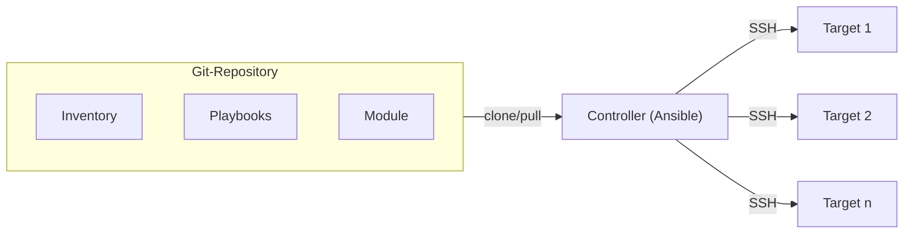

# Ansible

> **💡** Ansible automatisiert die Administration mehrerer Systeme über SSH. Diese Seite ist die kurze Übersicht; die Details stehen in den verlinkten Seiten.

## Architektur



Der **Controller** (Steuerrechner) liest das **Repository** (selbstdokumentierende single source of truth) mit **Inventory** (Inventar), **Playbooks** (Ablaufbeschreibungen) und **Modulen** (Bibliotheken).

Er verbindet sich per SSH mit den **Targets** (Zielsystemen); dort ist kein dauerhaft laufender Ansible-Agent nötig.

## Voraussetzungen

| System | Voraussetzung |
|---|---|
| Controller | Python 3, Ansible, SSH-Client, Git<br>(Empfehlung: Linux, macOS oder WSL; eigener Benutzer, nicht `root`) |
| Target | SSH-Server, Python 3, Benutzer mit `sudo`, öffentlicher Schlüssel in `~/.ssh/authorized_keys`<br>(Empfehlung: eigener Ansible-Benutzer) |
| Netzwerk | SSH-Port erreichbar<br>(Empfehlung: Port 22, Firewall freigegeben) |

> **🔐** Der SSH-Key ist der Zugang: Erst wenn der Key-Login ohne Passwort funktioniert, kann Ansible die Targets erreichen.

## Module finden

Offizielle Ansible-Dokumentation (latest):

* [Index](https://docs.ansible.com/ansible/latest/collections/index_module.html) (alle empfohlenen Module)
  * [`ansible.builtin`](https://docs.ansible.com/ansible/latest/collections/ansible/builtin/index.html) (Grundausstattung von Ansible)
  * [Collections](https://docs.ansible.com/ansible/latest/collections/index.html) (Sammlungen von Modulen, oft aus der Community)

Module statt Shell-Kommandos: Sie beschreiben den Sollzustand und sind idempotent.

## Grundlagen

* [1 Grundlagen: SSH und YAML](./1_grundlagen/README.md) — die vier SSH-Dateien und die YAML-Regeln.

### Deklarativ statt prozedural

Der Vorteil: Wir beschreiben das Ziel, nicht den Weg. Prozedural müssten wir jeden Befehl und jede Prüfung selbst schreiben. Bei Ansible sagen wir zum Beispiel „nginx soll installiert sein“, nicht „führe `apt-get install nginx` aus“. Das Modul entscheidet, was zu tun ist. Dadurch sind Playbooks kürzer, lesbarer und idempotent.

Ganz ehrlich: Playbooks werden von oben nach unten ausgeführt, und die Reihenfolge der Tasks ist wichtig. `when`, `loop` und `notify` steuern den Ablauf; `command` und `shell` sind prozedural. Ansible ist deshalb hybrid — deklarative Module, prozedurale Playbook-Steuerung.

### Idempotenz

Idempotent heißt: Egal, wie oft wir ein Playbook ausführen — das Ergebnis bleibt gleich. Ist der Sollzustand schon erreicht, ändert Ansible nichts. Beispiel: `state: present` installiert ein Paket nur, wenn es noch fehlt; beim nächsten Lauf meldet Ansible `changed=0`.

## Check-Mode und Diff

```bash
ansible-playbook --check --diff site.yml
```

`--check` ist der Probelauf und zeigt, was sich ändern würde; `--diff` zeigt die Dateiänderungen. Erst nach der Prüfung ohne diese Flags anwenden.

## Ausblick

* Rollen (`roles`) für wiederverwendbare Playbooks
* Ansible Vault für Geheimnisse
* Collections für weitere Module
* Rechteausweitung mit `become: true` (-> `sudo`)
* `ansible-lint` für die Qualitätssicherung

<!--
Didaktische Notizen (HTML-Kommentar, nicht im Buch sichtbar):
- Praxis vor Theorie: Die Schüler wollten selbst ausprobieren.
- Die meiste Zeit ging für Debugging drauf.
- opencode war beim Debugging eine gute Hilfe.
- SSH, Git und Unix-Kommandozeile waren die eigentliche Hürde.
- Mit den richtigen Modulen liefen die Dienste ohne viel Domainwissen.
- Session: etwa 10 Schüler, 4 Stunden nach dem Unterricht.
-->
